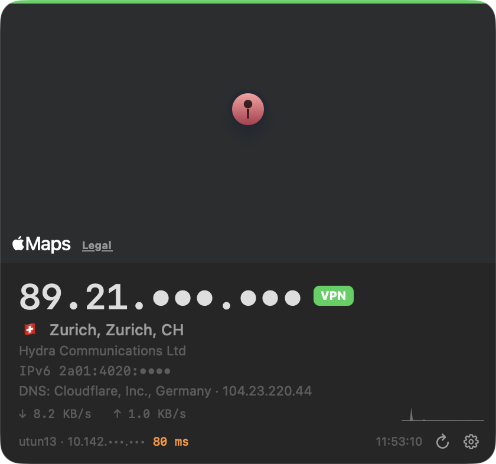

# IP Widget

[](https://github.com/wansiedler/ipwidget/actions/workflows/ci.yml)

A native macOS desktop widget that shows your public IP, its location on a live Apple Maps view,
your ISP, VPN state, DNS-leak verdict, latency and throughput — pinned to the desktop layer,
on every Space, with a menu bar item.



AppKit + MapKit + Network + SystemConfiguration, no dependencies, one `swiftc` call to build.
macOS 14+, Apple silicon (change `-target` in `build.sh` for Intel).

## Why

Menu bar IP apps show a number. This one shows where the number is, whether your VPN is actually
carrying your DNS queries, how fast the link is right now and what changed when — and every value
explains how it was computed when you hover it.

## Install

```bash
git clone https://github.com/wansiedler/ipwidget.git
cd ipwidget
./build.sh
```

`build.sh` compiles with `swiftc`, assembles `IPWidget.app`, signs it (Apple Development /
Developer ID identity from your keychain if present, ad-hoc otherwise), installs to
`/Applications` (or `~/Applications`), registers a launchd agent so the widget starts at login,
and starts it. No Xcode project needed; Xcode command line tools are enough.

Right-click the widget or click ⚙ for settings. Drag anywhere to move it.

### Features

| | |
|---|---|
| VPN / HOME badge | "Home network → Remember current network" stores the ISP; a different ISP shows a green **VPN** pill, same ISP a grey **HOME** pill |
| IPv6 | via `api6.ipify.org`; "IPv6 —" when there is no v6 connectivity |
| IP history | last 10 addresses with ISP and time in the ⚙ menu; click copies the IP |
| Notification | macOS notification "IP changed: old → new" (toggle in menu) |
| Change sound | system sound (Glass by default, any of /System/Library/Sounds or off) played via NSSound on IP change, independent of notification settings; picking a sound in "Sound on IP change" previews it |
| Local network | active interface (Wi‑Fi / Ethernet / utunN for VPN), SSID when Location permission allows, local IPv4 |
| Latency | TCP connect time to 1.1.1.1:443, green < 50 ms, orange < 150 ms, red above |
| Appearance | blur material (HUD / Popover / Sidebar / Titlebar), force dark theme |
| Size | compact (no map, 300 px) / normal (340, map 150) / large (420, map 220) |
| Map click | opens the location in Apple Maps; drag anywhere (map included) moves the widget |
| Reverse DNS | PTR hostname of the public IP next to the ISP |
| Language | English or Russian, following the system language; override in ⚙ → Language. All strings live in `L10n.swift` (English keys, Russian table) |
| Tooltips | hovering any value explains how it is computed (data source, method, thresholds); DNS and ping tooltips append the current verdict / per-target details. Drawn by the widget itself (`HoverTip`), since system tooltips never show for a desktop-level accessory app |
| Click to copy | IP, place, ISP/host, IPv6 and latency copy their value; the DNS and local-network rows copy the whole line; label flashes green |

### Network monitor

| | |
|---|---|
| DNS leak | `edns.ip-api.com` reports the resolver that answered our lookup. With VPN on it is a **leak** when the system DNS (primary service, via SCDynamicStore) points at the LAN router or the resolver belongs to the remembered home ISP; a private tunnel resolver (10.x etc.), a public resolver (Cloudflare/Google/Quad9/…) or the exit ISP's resolver is fine. Row shows org, country and resolver IP, tooltip explains the verdict, click copies the whole line |
| VPN detection | instant: default route via `utun*/ipsec*/ppp*` → VPN badge without waiting for the IP fetch; the name of the VPN service that owns the active tunnel (SCDynamicStore) is shown in the local row, other connected VPNs in its tooltip; tunnels without a service record (Amnezia/AWG) show just the interface |
| Throughput | ↓/↑ rate from the active interface byte counters (1 s sampling, 32-bit wrap handled) + 60 s sparkline |
| Status stripe | 3 px bar on top: green ok · yellow IP changed < 60 s · red offline / DNS leak / latency > 150 ms |
| Hotkey ⌃⌥I | floats the widget above all windows for 3 s and copies the IP (Carbon hotkey, no Accessibility permission) |
| All screens | one widget per display, each remembers its own position |
| Menu bar item | `🇨🇭 89.21.64.156` (or flag only), ⚠︎ on DNS leak, red when status is bad; same settings menu |
| History export | CSV to `~/Downloads`, up to 500 entries kept |
| Ping targets | any set of 1.1.1.1 / 8.8.8.8 / 9.9.9.9 / gateway / custom hosts; shows the worst, tooltip lists all |
| Speed test | Cloudflare `__down` 20 MB + `__up` 8 MB → Mbps, on demand, shown for 60 s |
| Mask IP | `89.21.•••.•••` everywhere (widget + menu bar) for screen sharing; "hide widget" keeps only the menu bar |
| Rebuild | menu item runs `git pull --ff-only` (if a remote exists) + `build.sh` detached; repo path injected into Info.plist by build.sh |

## App Store variant

The `appstore` branch is also an App Store–ready build (`xcodegen generate` + `xcodebuild`):
sandboxed, hardened runtime, HTTPS-only data source (ipwho.is), login item via `SMAppService`.
See [APPSTORE.md](APPSTORE.md).

## Privacy

Your public IP is sent to the geolocation services listed above (ip-api.com or ipwho.is,
ipinfo.io as fallback, api6.ipify.org for IPv6, edns.ip-api.com for the resolver check,
Cloudflare for the speed test). Nothing is sent anywhere else and nothing is stored outside
your Mac. The Wi‑Fi name needs the Location permission on macOS 14+ and is off by default.

## Control

```bash
launchctl kickstart -k gui/$(id -u)/com.wansiedler.ipwidget   # restart
launchctl bootout   gui/$(id -u)/com.wansiedler.ipwidget      # stop + disable until next build.sh
```

Uninstall: bootout, then delete `/Applications/IPWidget.app` and the LaunchAgents plist.

Logs: `~/Library/Logs/IPWidget/` (launchd stderr, rebuild output).

## License

MIT — see [LICENSE](LICENSE).
